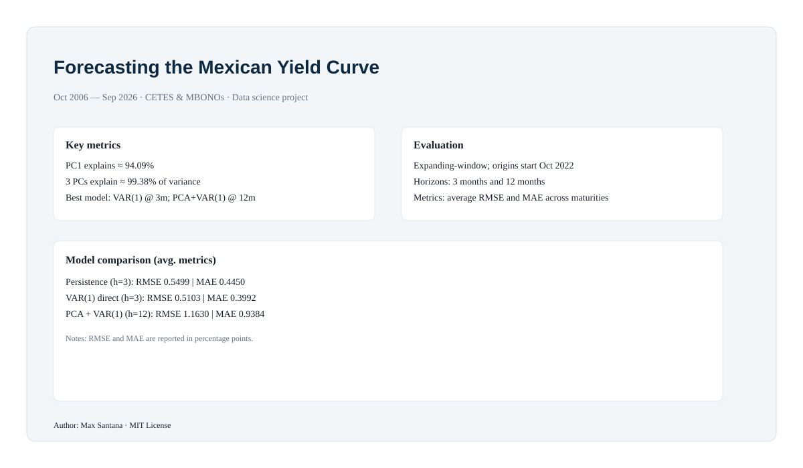

# Forecasting the Mexican Yield Curve

A concise data-science project: analysis and forecasting of Mexico’s nominal yield curve using monthly Banxico auction rates (Oct 2006 – Sep 2026).

## Quick summary
- Goal: find a low-dimensional representation of the curve (PCA) and evaluate forecasting strategies.
- Models: Persistence (benchmark), direct VAR(1) on monthly changes, PCA (3 PCs) + VAR(1) on factor scores.
- Evaluation: expanding-window forecasts starting Oct 2022; horizons = 3 and 12 months; metrics = average RMSE and MAE across maturities.
- Key result: 3 PCs ≈ 99.38% variance (PC1 ≈ 94.09%). VAR(1) best at 3m; PCA+VAR(1) best at 12m (under the chosen design).

## Visual gallery
Infographic (overview)

PCA & reconstruction (representative)

Model comparison (avg. metrics)

(If an image does not render, add the corresponding file under `docs/` or `outputs/figures/`.)

## Files you should have locally
- `notebooks/analisis_curva_banxico.ipynb` — main notebook (add locally if not in repo)
- `data/raw/banxico_auction_rates_monthly.csv` — raw data (required to run scripts)
- `_run_ffill_comparison.py`, `_generate_brief_pdf.py`, `_refresh_main_notebook_outputs.py`, `_restore_levels_changes_explanation.py`, `_extract_pdf.py`, `_extract_text_pdf.py` — utility and analysis scripts

## Run (minimal)
1. Clone repo
2. Create venv and install: pandas, numpy, scikit-learn, statsmodels, matplotlib, pymupdf, pillow
3. Place raw CSV at `data/raw/banxico_auction_rates_monthly.csv`
4. Run: `python _run_ffill_comparison.py`

## License & tags
MIT
Topics: data-science, time-series, forecasting, PCA, economics
