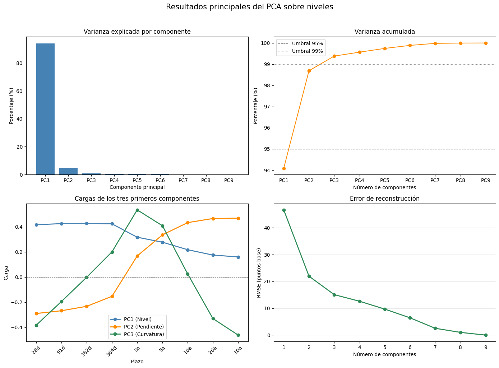
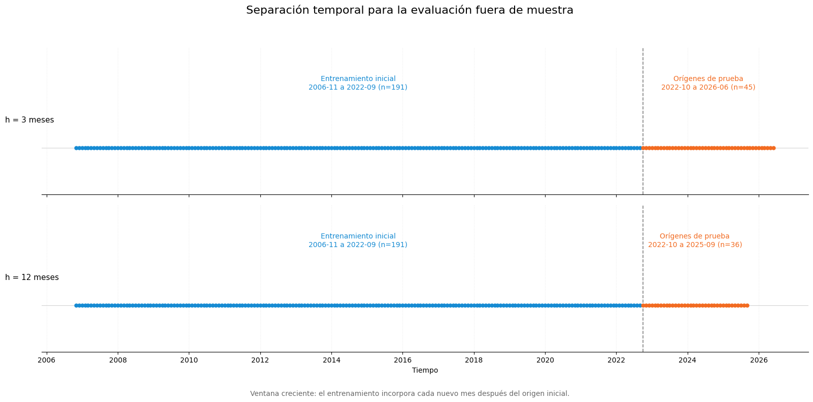
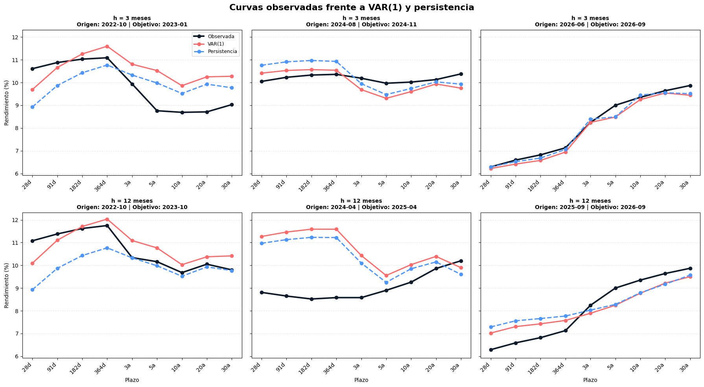
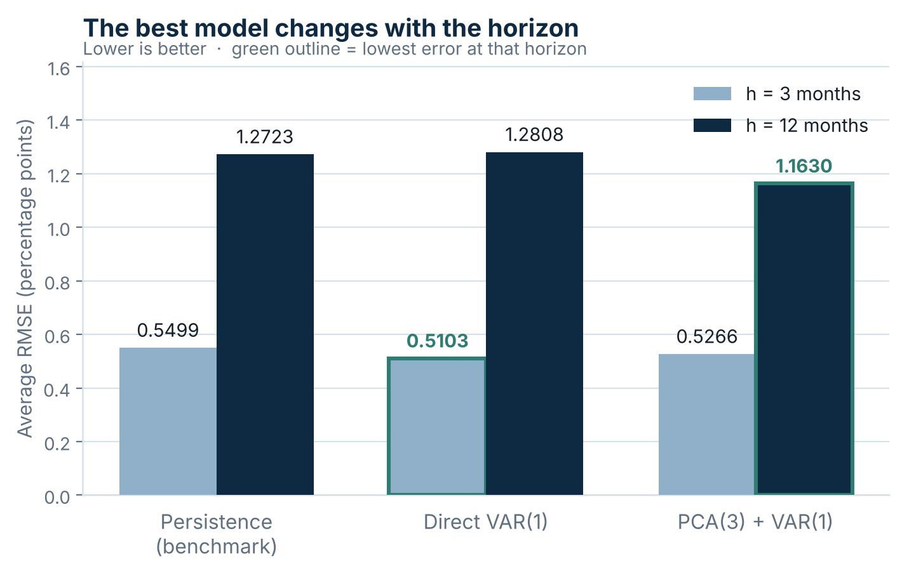

# Forecasting the Mexican Yield Curve — Common Structure and Out-of-Sample Evaluation

     

## 🔍 Overview

Nine nominal maturities of the Mexican yield curve — CETES at 28, 91, 182 and 364 days, MBONOS at 3, 5, 10, 20 and 30 years — observed monthly from October 2006 to September 2026: 1,936 records across 240 months. The question is whether the curve's common structure, extracted with PCA, forecasts better than simply assuming rates stay where they are.

**Three components explain 99.38% of the variation** — level (94.09%), slope (4.60%) and curvature (0.69%) — and reconstruct the nine rates with an RMSE of 15.07 basis points. But explaining the curve and forecasting it are different problems: against an expanding-window evaluation starting October 2022, **direct VAR(1) has the lowest error at 3 months and PCA + VAR(1) at 12 months**. Neither model dominates the other, and persistence — the benchmark — beats one of them at each horizon.

The missing-data treatment is reported as part of the result rather than as a preprocessing footnote: only 40 of 240 months observe all nine maturities, so the forward-fill decision shapes what the error metrics mean. The conclusions are labelled **exploratory** for that reason, and the tests that would settle the question are listed in [Next Steps](#-next-steps) rather than implied anywhere in the findings.

[](https://raw.githubusercontent.com/maxsantana-data2strategy/forecasting-mexican-yield-curve/main/assets/Infographic_YieldCurve_EN.jpg)
[](https://maxsantana-data2strategy.github.io/forecasting-mexican-yield-curve/analisis_curva_banxico_notebook.html)

---

## 🎯 Problem Statement

**Business Question:** Does the common structure of the yield curve help forecast it — and does the answer depend on the horizon?

A yield curve is nine correlated series that move together most of the time. If that co-movement can be compressed into a handful of factors, a forecaster has a smaller, better-conditioned problem to solve. Whether the compression actually *helps* is an empirical question, and one that has to be answered against a benchmark that is genuinely hard to beat.

Supporting questions:

1. How many factors are needed to describe nine maturities at once, and what do they mean economically?
2. Which benchmark is the right one to beat — last observed level, historical mean, or moving average?
3. Can either model improve on that benchmark at 3 and 12 months?
4. Is a single model best at every horizon, or does the choice depend on it?
5. How much of the answer rests on how missing auctions were handled?

---

## 💡 What I Did

### Section 1: Reshape and Audit

The source arrives in long format and is pivoted to a monthly matrix, one maturity per column. No duplicates or missing values exist in the long file — **the gaps appear when the dates are aligned**, because the long maturities are not auctioned every month.

Missing coverage by maturity: **1.7%** at 3 years, **6.7%** at 5, **26.2%** at 10, **28.7%** at 20 and **30.0%** at 30. Only **40 of 240 months** observe all nine maturities at once, so dropping incomplete months would have left a joint sample too small to model.

### Section 2: Causal Forward-Fill

The monthly calendar is kept and each gap takes the **last past observation, never future information**. The first missing value at 20 years stays NaN rather than being back-filled.

Order matters here: the fill is applied **before** trimming the sample to November 2006, not after. The corrected sequence yields **239 monthly levels and 238 changes** across nine maturities with zero remaining nulls — `_run_ffill_comparison.py` exists precisely to compare the two orderings and document the difference.

As a descriptive control, the minimum pairwise correlation between maturities is **0.73** on the completed sample and **0.70** using only the 40 originally complete months — the co-movement is not an artifact of the fill. Banxico's policy rate is used only to validate the level factor, never as a predictor.

### Section 3: PCA on Levels

PCA is estimated on the nine rates **in levels and unstandardized**, so that genuine differences in variability across maturities are preserved rather than normalized away.

The first three components explain **99.38%** of the variation: **PC1 94.09%, PC2 4.60%, PC3 0.69%**. The loadings carry the standard interpretation — PC1 the same sign across all maturities (**level**), PC2 a contrast between short and long (**slope**), PC3 the middle against the extremes (**curvature**). Reconstruction from three components has an RMSE of **15.07 basis points**.

### Section 4: Choosing the Benchmark

Three naive rules were compared: last observed level, expanding historical mean, and 12-month moving average. **Persistence won**, and it is the benchmark the models are measured against — picking the weakest of the three would have made the models look better for no analytical reason.

### Section 5: Two Forecasting Strategies

**Direct VAR(1)** models the monthly changes of all nine maturities jointly; forecast changes are accumulated onto the last observed level.

**PCA(3) + VAR(1)** re-estimates the PCA at every origin, keeps three factors, forecasts the scores with a VAR(1), and inverse-transforms back to the nine rates. Re-estimating at each origin is what keeps the factors from being contaminated by data the forecaster would not have had.

### Section 6: Expanding-Window Evaluation

Training ends **September 2022**; evaluation origins start **October 2022** and the window expands. That yields **45 origins at h = 3** and **36 at h = 12**, with 236 and 227 training observations respectively at the final origin. Metrics are RMSE and MAE averaged across the nine maturities, in percentage points.

---

## 🛠️ Technologies Used

| Category | Tools |
|----------|-------|
| **Python** | pandas, numpy |
| **Dimensionality reduction** | `sklearn.decomposition.PCA` — fit on levels, `inverse_transform` for reconstruction |
| **Time series** | `statsmodels.tsa.api.VAR` — VAR(1) on monthly changes and on factor scores, expanding-window `forecast` |
| **Visualization** | matplotlib, PIL |
| **Techniques** | Long-to-wide reshaping, missingness audit, causal forward-fill, principal component analysis, vector autoregression, benchmark selection, expanding-window out-of-sample evaluation, RMSE/MAE comparison by horizon |
| **Environment** | Jupyter Notebook |

---

## 📊 Key Findings

| Result | Method | Value | Read |
|---|---|---|---|
| Common structure | PCA on 9 levels | **99.38% in 3 components** | PC1 level 94.09%, PC2 slope 4.60%, PC3 curvature 0.69% |
| Reconstruction quality | 3-component inverse transform | **15.07 bp RMSE** | Three numbers per month reproduce nine rates to within ~0.15 pp |
| Best model at h = 3 | Expanding window, 45 origins | **Direct VAR(1) — RMSE 0.5103** | 7.2% below persistence (0.5499); MAE 0.3992 vs 0.4450 (−10.3%) |
| Best model at h = 12 | Expanding window, 36 origins | **PCA + VAR(1) — RMSE 1.1630** | 8.6% below persistence (1.2723); MAE 0.9384 vs 1.0584 (−11.3%) |
| Direct VAR(1) at h = 12 | Same design | **RMSE 1.2808** | 0.7% *worse* than persistence — the direct model does not carry to the long horizon |
| PCA + VAR(1) at h = 3 | Same design | **RMSE 0.5266** | Better than persistence but 0.0163 above direct VAR(1) — compression costs something at short horizons |
| Benchmark selection | Persistence vs mean vs 12-month MA | **Persistence** | The hardest of the three to beat; used for every comparison |
| Data availability | Coverage audit | **40 of 240 months complete** | 26.2% / 28.7% / 30.0% missing at 10 / 20 / 30 years |
| Co-movement | Minimum pairwise correlation | **0.73** | 0.70 on the 40 originally complete months — not an artifact of the fill |

### Model comparison

| Model | h = 3 RMSE | h = 3 MAE | h = 12 RMSE | h = 12 MAE |
|---|---|---|---|---|
| Persistence (benchmark) | 0.5499 | 0.4450 | 1.2723 | 1.0584 |
| Direct VAR(1) | **0.5103** | **0.3992** | 1.2808 | 1.0680 |
| PCA(3) + VAR(1) | 0.5266 | 0.4193 | **1.1630** | **0.9384** |

Average across the nine maturities, in percentage points. Bold marks the lowest error per horizon and metric.

### The curve in three factors



Variance per component and cumulative share, the PC1–PC3 loadings that give the factors their level / slope / curvature reading, and reconstruction error by number of components.

### Train/test separation



The evaluation respects time order: nothing after an origin enters the model that forecasts from it.

### Observed vs forecast curves



Representative dates at both horizons, direct VAR(1) against persistence.

### Where each model wins



Average RMSE across the nine maturities. Direct VAR(1) is lowest at 3 months, PCA + VAR(1) at 12 — and direct VAR(1) falls behind the benchmark at the longer horizon.

### Context → Findings → Implications (C→F→I)

**📍 Context:** Nine nominal maturities, 240 months, and a benchmark that is hard to beat — persistence outperformed both the expanding historical mean and the 12-month moving average. Only 40 months observe every maturity, so how the gaps are handled is part of the result rather than a footnote to it.

**🔍 Findings:**

1. **The curve is three numbers wide.** PC1, PC2 and PC3 account for 99.38% of the variation and reconstruct the nine rates to 15.07 bp. Level alone carries 94.09%
2. **The factors are economically readable.** Same sign everywhere (level), short-against-long (slope), middle-against-extremes (curvature) — the standard decomposition appears without being imposed
3. **At 3 months, modelling changes directly wins.** VAR(1) at 0.5103 against persistence at 0.5499, a 7.2% reduction in RMSE and 10.3% in MAE
4. **At 12 months, it loses to the benchmark.** The same VAR(1) returns 1.2808 against persistence's 1.2723 — 0.7% worse. What works at one horizon does not transfer
5. **At 12 months, the common structure is what pays.** PCA + VAR(1) returns 1.1630, 8.6% below persistence and 9.2% below direct VAR(1) — the biggest gap in the table
6. **Compression is not free at short horizons.** PCA + VAR(1) beats persistence at h = 3 but trails direct VAR(1) by 0.0163 — discarding 0.62% of variance discards some of what matters over three months
7. **The co-movement is real, not manufactured.** Minimum pairwise correlation is 0.73 after filling and 0.70 on the untouched complete months

**💡 Implications:**

- ✅ **Select the model by horizon.** Direct VAR(1) at 3 months, PCA + VAR(1) at 12 — under this evaluation design, no single specification dominates
- 🎯 **Use the factor representation where persistence degrades most.** The structure's advantage grows with the horizon, which is exactly where the naive rule falls apart
- ⚠️ **Treat these results as exploratory.** Forward-fill can create monthly changes of exactly zero and make some evaluated values represent the last available auction rather than a new one. No test of statistical significance between models was run
- 📋 **Do not read PC1 as a policy-rate proxy.** Banxico's target rate validated the level factor; it was never a predictor, and the factors are descriptive of the curve, not causal
- 📊 **Fix the auction-availability treatment before any decision use.** It is the first item in Next Steps for a reason: it is the limitation most likely to change the error ranking

---

## 🚀 How to Use

```
forecasting-mexican-yield-curve/
├── notebooks/
│   └── analisis_curva_banxico.ipynb      # main analysis
├── data/
│   ├── raw/
│   │   ├── banxico_auction_rates_monthly.csv   # not yet committed
│   │   └── tasa_banxico.xlsx                   # policy rate, validation only
│   └── processed/
│       └── tasas_mensuales_forward_fill.csv    # not yet committed
├── scripts/
│   └── run_ffill_comparison.py           # fill-order comparison
├── outputs/
│   └── figures/                          # charts used by the brief and README
├── docs/
│   └── analisis_curva_banxico_notebook.html  # rendered notebook (GitHub Pages)
├── assets/
│   └── Infographic_YieldCurve_EN.jpg
├── LICENSE
└── README.md
```

1. **Read without running** — the notebook retains its executed output, so the analysis is readable as-is on GitHub, and the rendered HTML export is linked at the top of this README
2. **Run it yourself** — the notebook resolves its paths relative to the repository root, so no configuration is needed once the three input files below are in place:

```bash
git clone https://github.com/maxsantana-data2strategy/forecasting-mexican-yield-curve.git
cd forecasting-mexican-yield-curve
python -m venv .venv && source .venv/bin/activate
pip install pandas numpy scikit-learn statsmodels matplotlib pillow pymupdf jupyter
jupyter notebook notebooks/analisis_curva_banxico.ipynb
```

3. **Reproduce the fill-order check** — `python scripts/run_ffill_comparison.py` prints both treatments side by side

> **Input data not yet committed.** `data/raw/banxico_auction_rates_monthly.csv`, `data/raw/tasa_banxico.xlsx` and `data/processed/tasas_mensuales_forward_fill.csv` are required to execute the notebook. Until they are added, the repository is readable end to end but not runnable.

### Dataset schema

| Column | Type | Description |
|---|---|---|
| `DATE` | date | First day of the month |
| `INSTRUMENT` | categorical | One of nine: CETEs 28/91/182/364 days, MBONOs 3/5/10/20/30 years |
| `VALUE_PCT` | float | Monthly average auction rate, percentage points |

**Unit of analysis:** one row per instrument-month in the source; one row per month and nine columns after reshaping.
**Source:** Banco de México — monthly average primary-auction rates.

---

## ⚖️ Limitations

- **Forward-fill is the central limitation.** It preserves continuity, but it also produces monthly changes of exactly zero and makes some evaluated values the last available auction rather than a new one. Error metrics computed over those months are not measuring a fresh forecast error
- **No test of predictive significance.** The ranking rests on average RMSE and MAE; Diebold-Mariano or an equivalent was not run, so "VAR(1) is better at h = 3" means lower average error, not a statistically established difference
- **Only VAR(1) was estimated.** Lag order was fixed at one rather than selected by information criterion, and no alternative order was compared
- **Three components were fixed in advance.** The 99.38% figure justifies the choice descriptively, but the number of factors was not re-selected at each origin the way the PCA itself was re-estimated
- **One evaluation design.** A single training cut-off (September 2022) and two horizons; the ranking is not shown to be stable across other cut-offs or horizons
- **The test period is unusual.** October 2022 onward covers a specific rate cycle; it is not a neutral sample of yield-curve behavior
- **Levels, not excess returns.** The analysis forecasts rates; it says nothing about tradability, carry, or whether the error reductions survive transaction costs
- **PCA is estimated on levels, which are non-stationary.** This is standard practice for curve decomposition and is why forecasting is done on changes and factor scores, but the decomposition itself inherits the issue

## 🧭 Next Steps

The analyses below were **not performed here**. Each one closes a specific gap that the current evidence leaves open.

**Fix the data treatment first**

1. **Cross-sectional curve estimation for unobserved months** — fit the curve across maturities within each month instead of propagating the last rate forward. This is the single change most likely to alter the error ranking
2. **Flag months with an effective auction** and compute changes and errors only over them, so the metrics measure real forecast error
3. **Re-run the full evaluation on the corrected base** and compare the ranking to the one reported here

**Strengthen the model comparison**

4. **Diebold-Mariano tests** on the loss differentials, so "lower RMSE" becomes a tested claim
5. **Lag-order selection** by AIC/BIC at each origin, and comparison of VAR(2) and VAR(3) against VAR(1)
6. **Factor-count sensitivity** — re-run with 2, 3 and 4 components to see how much of the h = 12 advantage depends on keeping exactly three
7. **Rolling window alongside the expanding one**, to test whether the older observations help or hurt

**Extend the question**

8. **Nelson-Siegel or Svensson parameterization** as an alternative three-factor representation with imposed economic shape
9. **Multiple training cut-offs** to check that the horizon-dependent ranking is not specific to September 2022
10. **Per-maturity error decomposition** — the averages hide which maturities each model wins and loses on

---

## 📚 Learnings & Best Practices

- **The order of preprocessing steps is a result, not a detail.** Filling before trimming versus after changes the sample and the metrics. `scripts/run_ffill_comparison.py` exists so that the difference is documented rather than assumed away
- **Pick the hardest benchmark, not the most flattering one.** Persistence beat the historical mean and the moving average, which is exactly why it is the one worth being measured against
- **Explaining variance and forecasting are different objectives.** 99.38% explained does not imply better forecasts — at h = 3 the compressed model loses to the direct one, with the discarded 0.62% as the plausible cost
- **Re-estimate everything inside the loop.** A PCA fitted once on the full sample and reused at every origin leaks future information into the factors; re-fitting at each origin is what makes the comparison honest
- **Report the horizon-dependence instead of hiding it.** A table showing one model winning at 3 months and another at 12 is more useful than a single "best model" claim that holds in one column and fails in the other
- **State what the fill does to the metric.** Monthly changes of exactly zero are an artifact of the treatment, and a reader who does not know that will over-read the error figures

---

**Author:** Max Santana — Data Analyst, Business Intelligence & Strategic Foresight · [GitHub](https://github.com/maxsantana-data2strategy) · [Portfolio](https://maxsantana-data2strategy.github.io)

**Status:** ✅ Analysis complete | **Data:** 1,936 records, 240 months, 9 maturities (Banco de México) | **Ready for Decisions:** ⚠️ Exploratory — see Limitations and Next Steps
